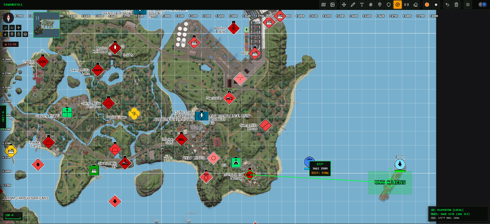
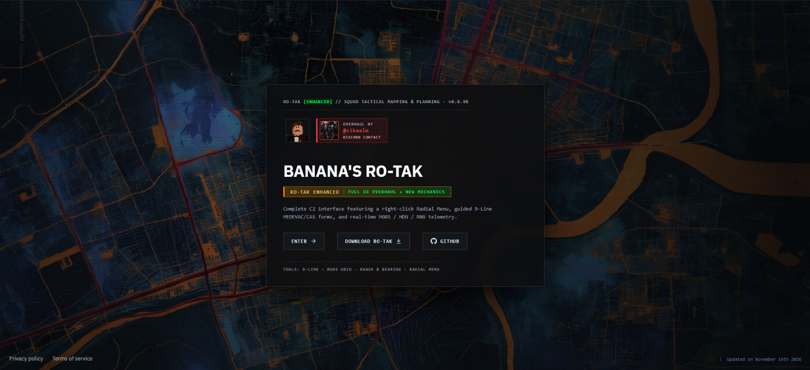
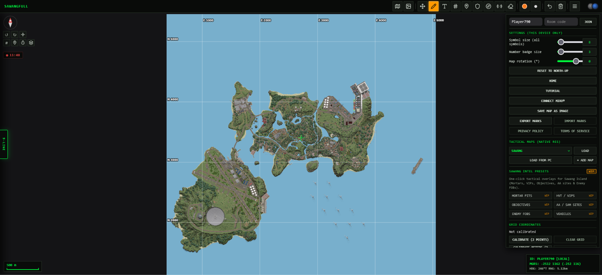
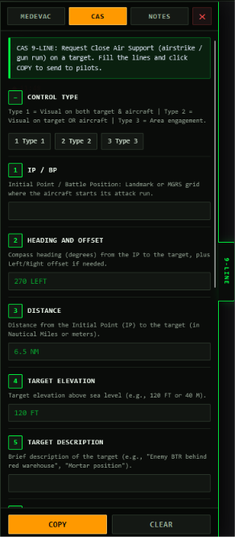
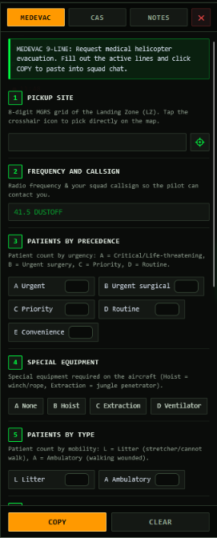
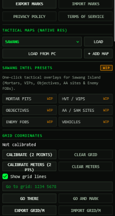

# RO-TAK // Zikam's Tactical Overhaul (Add-On)

> **Full ATAK-inspired C2 UI Overhaul & Tactical Mechanics Add-On for [Banana's RO-TAK](https://ro-tak.vercel.app/).**

This add-on injects a cleaner **Android Team Awareness Kit (ATAK)** command & control interface directly on top of the official **RO-TAK** web app (`https://ro-tak.vercel.app/`), preserving full multiplayer room compatibility with the base version while upgrading the HUD, navigation, and tactical tools.

### Live Tactical Operations & Enhanced Compass Rangefinder
Dragging the **Compass** tool displays live **Azimuth (`°`)**, **Target 8-Digit MGRS**, and **Real Distance (`m` / `km`)** directly over the line of sight, paired with real-time bottom-right telemetry.

---

## Quick Installation (1-Click Add-On)

1. Install a Userscript manager in your browser:
   * **Chrome / Edge / Brave:** [Tampermonkey](https://chromewebstore.google.com/detail/tampermonkey/dhdgffkkebhmkfjojejmpbldmpobfkfo?hl=es) or [Violentmonkey](https://chromewebstore.google.com/detail/violentmonkey/jinjaccalgkegednnccohejagnlnfdag?pli=)
   * **Firefox:** [Tampermonkey](https://addons.mozilla.org/es-CL/firefox/addon/tampermonkey/) or [Violentmonkey](https://addons.mozilla.org/en-US/firefox/addon/violentmonkey/)
2. Click the direct install link below and press **Install**:
   * **[Install RO-TAK Tactical Overhaul (`zikam-rotak-overhaul.user.js`)](https://github.com/zikalm666-prog/RO-TAK---Zikams-Overhaul/blob/main/zikam-rotak-overhaul.user.js)**
3. Open **[https://ro-tak.vercel.app/](https://ro-tak.vercel.app/)** (or refresh if already open). The overhaul loads automatically and stays up to date via GitHub.

---

## Interface Showcase

### 1. Custom Tactical Landing Screen
Topographic backdrop with author attribution (`@zikaalm`), custom tactical icons, and repository switcher (`[MOD]` / `[BASE]`).

### 2. Full C2 HUD & Sidebar Controls
Sharp monospace C2 header, top-right tool dock, center reticle, dynamic zoom scale bar, and live **MGRS / HDG / RNG** telemetry.

### 3. Guided 9-Line MEDEVAC / CAS & Native Map Loader
* **Didactic 9-Line Drawer:** Built-in tactical field guide explaining every line of **MEDEVAC** and **CAS** requests with one-click map grid picking and formatted clipboard export.
* **Native Map Selector & Sawang Presets `[WIP]`:** Load full-resolution maps (**Sawang 15K** & **Ronograd 16K**) and 2-point MGRS/meter calibrations straight from the `≡` menu.

| MEDEVAC 9-Line Guide | CAS 9-Line Guide | Native Maps & Presets |
| :---: | :---: | :---: |
|  |  |  |

---

## Key Mechanics & Controls

* **Right-Click ATAK Radial Menu:** Tap `Right-Click` anywhere on the map to deploy an 8-petal circular tool wheel (`Symbols`, `Waypoints`, `Compass`, `Ping`, `Draw`, `Text`, `Eraser`, `Move/Pan`). Hold `Right-Click + Drag` to pan smoothly.
* **One-Click MGRS Copy (`Ctrl + Click`):** Hold `Ctrl` and left-click any calibrated point on the map to copy its exact 8-digit MGRS coordinate to your clipboard.
* **Enhanced Compass & Rangefinder:** Dragging the compass displays **Azimuth (`°`)**, **Target 8-Digit MGRS**, and **Real Distance (`m` / `km`)** in real time.
* **Didactic NATO Symbol Builder:** Visible inline descriptions and examples for MIL-STD-2525D / APP-6D fields.

| Action | Shortcut / Input |
| :--- | :--- |
| **Deploy ATAK Radial Menu** | `Right-Click` (tap) on map |
| **Pan Map** | `Right-Click + Drag` or `Middle-Click + Drag` |
| **Copy 8-Digit MGRS** | `Ctrl + Left-Click` on map |
| **Measure Bearing & Range** | Select **Compass** tool + `Drag` |
| **Zoom / Rotate Map** | `Scroll` / `Alt + Scroll` |
| **Reset North-Up** | Click top-left **Compass** |
| **Undo / Paste Map** | `Ctrl + Z` / `Ctrl + V` |
| **Close Menus / Cancel** | `Esc` |

---

## Credits & Attribution

* **Original Project:** [Banana's RO-TAK](https://github.com/rice-evans/RO-TAK) by **rice-evans** (MIT License).
* **UI Overhaul & Add-On Mechanics:** **Zikam** (`@zikaalm` on Discord).